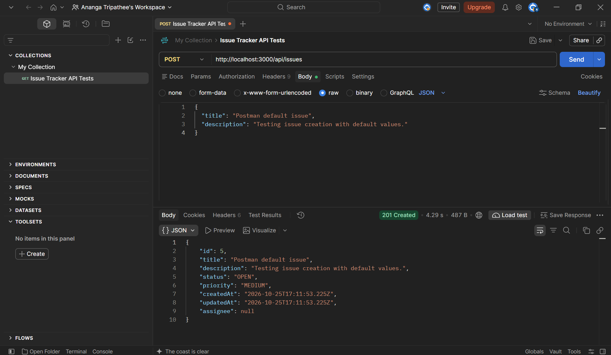
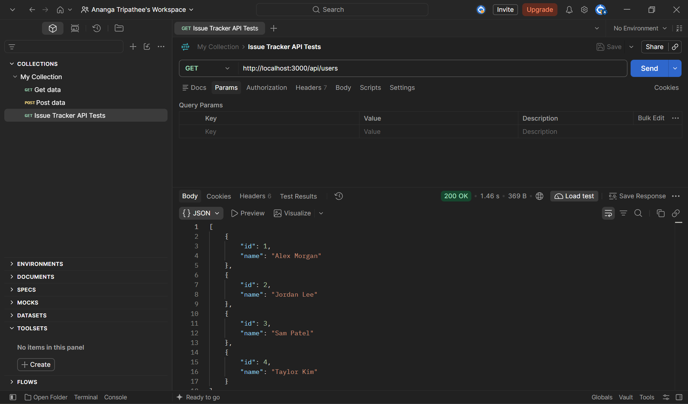
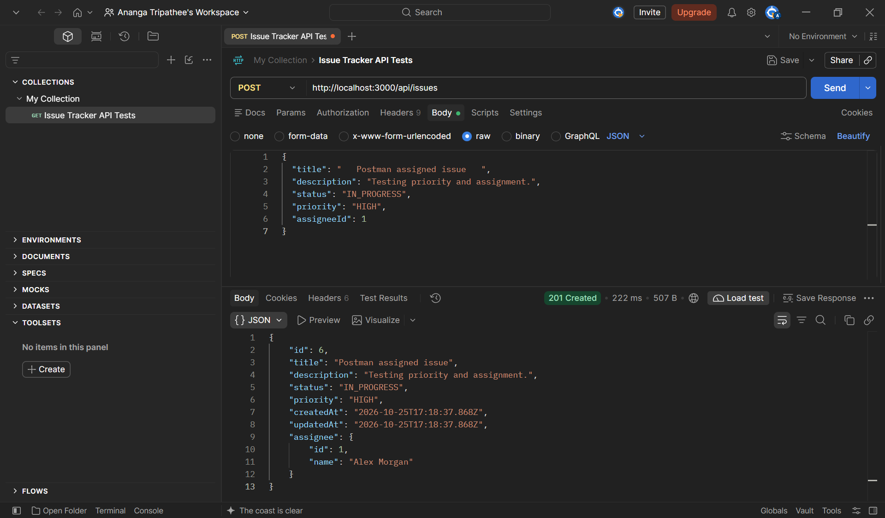
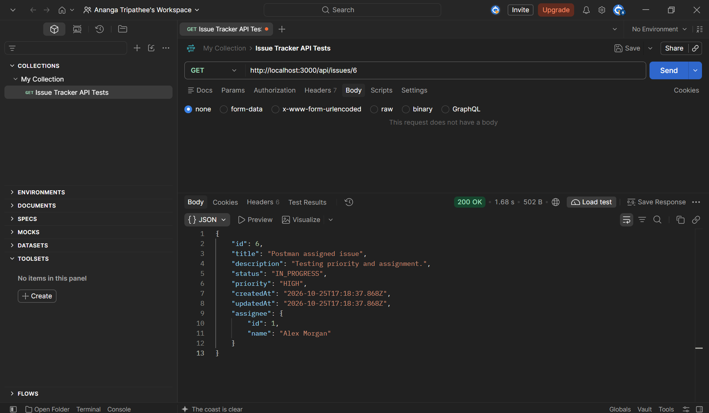
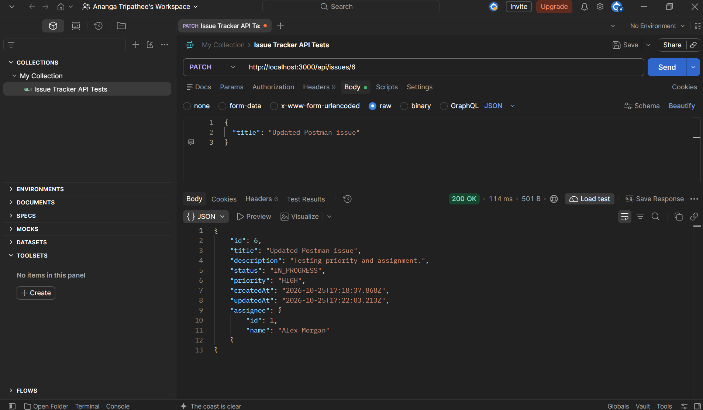
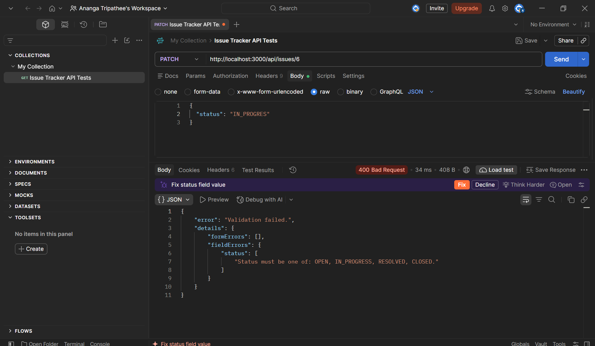

# Manual API Testing

I used Postman to check the API directly while developing the issue tracker. These examples show the requests I sent, the responses I inspected, and why each check matters.

The screenshots were captured during development on a local server at `http://localhost:3000`. Issue and user IDs belong to that local database; use IDs returned by your own requests when repeating the checks. Timings shown in Postman are individual request timings, not performance benchmarks.

## Verification overview

| Check | Request | Expected status | Observed status |
| --- | --- | --- | --- |
| Create with defaults | `POST /api/issues` | `201` | `201` |
| List available assignees | `GET /api/users` | `200` | `200` |
| Create with assignment and trimmed title | `POST /api/issues` | `201` | `201` |
| Retrieve the saved issue | `GET /api/issues/6` | `200` | `200` |
| Update only the title | `PATCH /api/issues/6` | `200` | `200` |
| Reject an invalid status | `PATCH /api/issues/6` | `400` | `400` |

All six examples below show the expected response. They are selected manual checks, not a complete test suite.

## 1. Create an issue with default values

**Request:** `POST /api/issues`

**Purpose:** Check that title and description are sufficient to create an issue and that omitted optional fields receive their defaults.

```json
{
  "title": "Postman default issue",
  "description": "Testing issue creation with default values."
}
```

**Expected:** `201 Created`, a new issue ID, status `OPEN`, priority `MEDIUM`, no assignee, and creation/update timestamps.



**Observed:** The response contains issue ID `5`, the submitted text, `OPEN`, `MEDIUM`, and `assignee: null`. Both timestamps are present and equal at creation.

**Result:** Pass.

## 2. Retrieve available assignees

**Request:** `GET /api/users`, with no request body.

**Purpose:** Find valid user IDs before testing assignment, rather than assuming an arbitrary ID exists.

**Expected:** `200 OK` with the seeded users' IDs and names.



**Observed:** The response lists Alex Morgan (`1`), Jordan Lee (`2`), Sam Patel (`3`), and Taylor Kim (`4`). I used Alex Morgan's ID in the next request.

**Result:** Pass.

## 3. Create an assigned issue and trim its title

**Request:** `POST /api/issues`

**Purpose:** Check explicit status, priority, and assignment together, and confirm surrounding title whitespace is removed.

```json
{
  "title": "   Postman assigned issue   ",
  "description": "Testing priority and assignment.",
  "status": "IN_PROGRESS",
  "priority": "HIGH",
  "assigneeId": 1
}
```

**Expected:** `201 Created`, a trimmed title, status `IN_PROGRESS`, priority `HIGH`, and Alex Morgan as assignee.



**Observed:** Issue `6` is returned with title `Postman assigned issue`, status `IN_PROGRESS`, priority `HIGH`, and an assignee object containing ID `1` and name `Alex Morgan`.

**Result:** Pass.

## 4. Retrieve the saved issue

**Request:** `GET /api/issues/6`, with no request body.

**Purpose:** Confirm that the issue created in the previous request can be read back through a separate endpoint.

**Expected:** `200 OK` with the same issue ID, text, status, priority, assignee, and timestamps.



**Observed:** The response returns issue `6` with the same values shown in the creation response, including its assignee and timestamps.

**Result:** Pass. This demonstrates retrieval after creation; persistence across a server restart is not shown by this screenshot alone.

## 5. Update only the title

**Request:** `PATCH /api/issues/6`

**Purpose:** Check partial-update behavior: changing one field should preserve fields omitted from the request.

```json
{
  "title": "Updated Postman issue"
}
```

**Expected:** `200 OK` with the new title, the original creation date, a later update date, and unchanged description, status, priority, and assignee.



**Observed:** The title changes to `Updated Postman issue`. Compared with the previous retrieval, the description, `IN_PROGRESS` status, `HIGH` priority, and Alex Morgan assignment remain unchanged. `createdAt` stays the same while `updatedAt` advances.

**Result:** Pass.

## 6. Reject an invalid status

**Request:** `PATCH /api/issues/6`

**Purpose:** Verify that the backend rejects an unsupported enum value instead of accepting a near-match or exposing a database error.

```json
{
  "status": "IN_PROGRES"
}
```

The missing final `S` is intentional in this example: `IN_PROGRES` is not a supported status.

**Expected:** `400 Bad Request` with a field-specific validation message identifying the allowed statuses.



**Observed:** The API returns `Validation failed.` with a `details.fieldErrors.status` message listing `OPEN`, `IN_PROGRESS`, `RESOLVED`, and `CLOSED`.

**Result:** Pass. This screenshot demonstrates rejection of invalid input, not a successful status change. A follow-up read would separately confirm the stored issue stayed unchanged.

## Automated coverage and remaining evidence

The repository also includes repeatable API checks for CRUD, assignment and unassignment, statuses, priorities, invalid inputs and IDs, search, and combined search/status filtering. The latest recorded run completed **112 checks with no failures**; the separate database-failure run completed **7 checks with no failures**.

See [automated test instructions](../scripts/README.md) to reproduce those checks against a separate test database. See the [API query reference](api.md) for search/filter parameters and examples.

I also manually checked the browser workflows, including editing, assignment, search and filtering, deletion confirmation, and not-found pages. Those checks are not illustrated by the Postman screenshots here. Deletion, search/filter results, invalid assignees, and database-failure responses are likewise not pictured in this selected evidence set.

The screenshots capture specific development checks. Automated results are recorded separately and should be rerun to verify a new environment.
